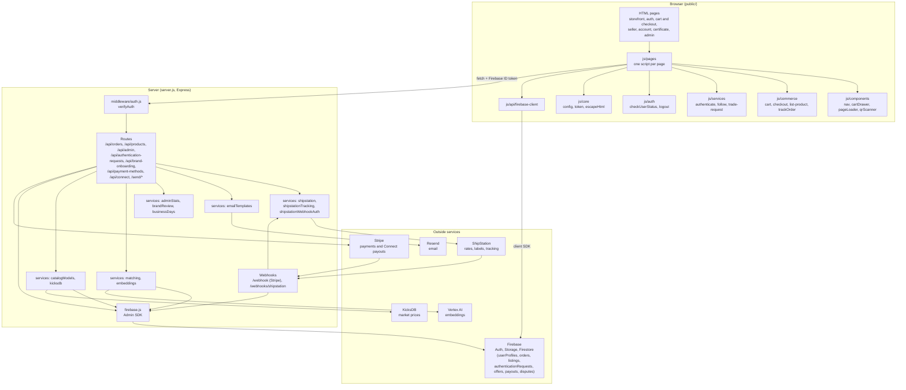

# Hexxo-Ecommerce-App

A full-stack e-commerce platform built with JavaScript, Node.js, Express.js, and Firebase. This all-in-one marketplace connects sneaker and streetwear enthusiasts, allowing users to buy, sell, and trade.

## Table of Contents

- [Overview](#overview)
- [Built With](#built-with)
- [Architecture](#architecture)
- [Features](#features)
- [Prerequisites](#prerequisites)
- [Installation](#installation)
- [Usage](#usage)
- [Contact](#contact)

## Overview

Hexxo is a modern e-commerce platform designed specifically for sneaker and streetwear enthusiasts. Our platform provides a seamless experience for buying, selling, and discovering the latest in street fashion.

### Built With
* HTML
* CSS
* JavaScript
* Node.js
* Express.js
* Firebase

## Architecture

Three layers: the browser, the Express server, and outside services. Data moves two ways only: through the server's API, or straight from the browser to Firebase.



## Features

- **User Authentication**
  - Secure login/register system
  - Profile management
  
- **Product Management**
  - Add sneakers/streetwear listings
  - Upload product images
  - Set prices and descriptions

- **Shopping Experience**
  - Browse products by category
  - Size selection
  - Add to cart functionality
  - Notify for availability

- **Real-Market Pricing**
  - Pricing suggestions for listings based on real market data

- **Three-Tier Authentication**
  - Tier 1 — QuickCheck: fast automated authentication (currently released)
  - Tier 2 — Expert + AI-assisted authentication (planned)
  - Tier 3 — Expert physical inspection: item is shipped to an expert for review, then shipped back (planned)

## Prerequisites

Before installing, make sure you have:

- [Node.js](https://nodejs.org/) (LTS) and npm
- A [Firebase](https://firebase.google.com/) project with Auth, Firestore, and Storage enabled
- A [Stripe](https://stripe.com/) account (Payment Intents + webhook secret)
- A `.env` file in the project root defining:
  - `PORT` (optional, defaults to `3030`)
  - `FIREBASE_CONFIG`
  - `STRIPE_SECRET_KEY`
  - `STRIPE_ENDPOINT_SECRET`
  - `ADMIN_EMAIL`
  - `RESEND_API_KEY`
  - `KICKDB_KEY`
  - `SHIPSTATION_KEY`
  - `SHIPSTATION_SECRET_KEY`
  - `SHIPSTATION_V2_API_KEY`
  - `SHIPSTATION_WEBHOOK_TOKEN`

## Installation

1. Clone the repository
```bash
git clone https://github.com/DatravousOdds/H2T-Ecommerce-App.git
```
2. Install dependencies
```bash
npm install
```
3. Add your `.env` file with the variables listed under [Prerequisites](#prerequisites)
4. Start the server
```bash
npm start
```

## Usage

Once the server is running, open the storefront in your browser:

```bash
npm start
# Server listening on http://localhost:3030 (or your custom PORT)
```

Navigate to `http://localhost:3030` to browse listings, and to `/account` or `/auth/login` to test the account flows.

# Contact

 Datravous Odds - datravousodds@gmail.com

 Project Link: https://github.com/DatravousOdds/H2T-Ecommerce-App

